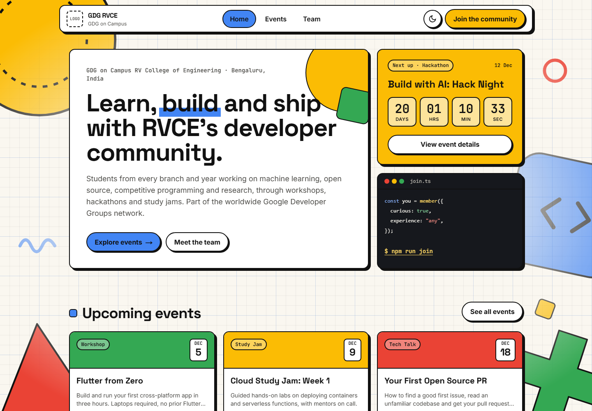
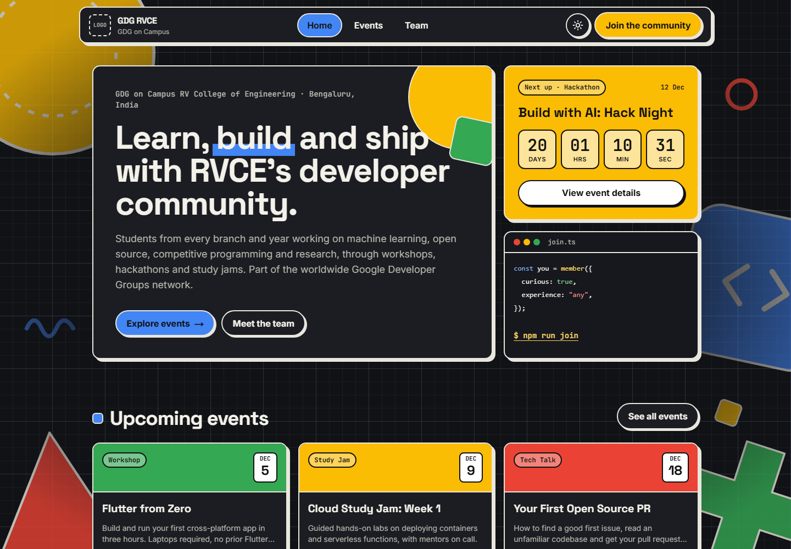
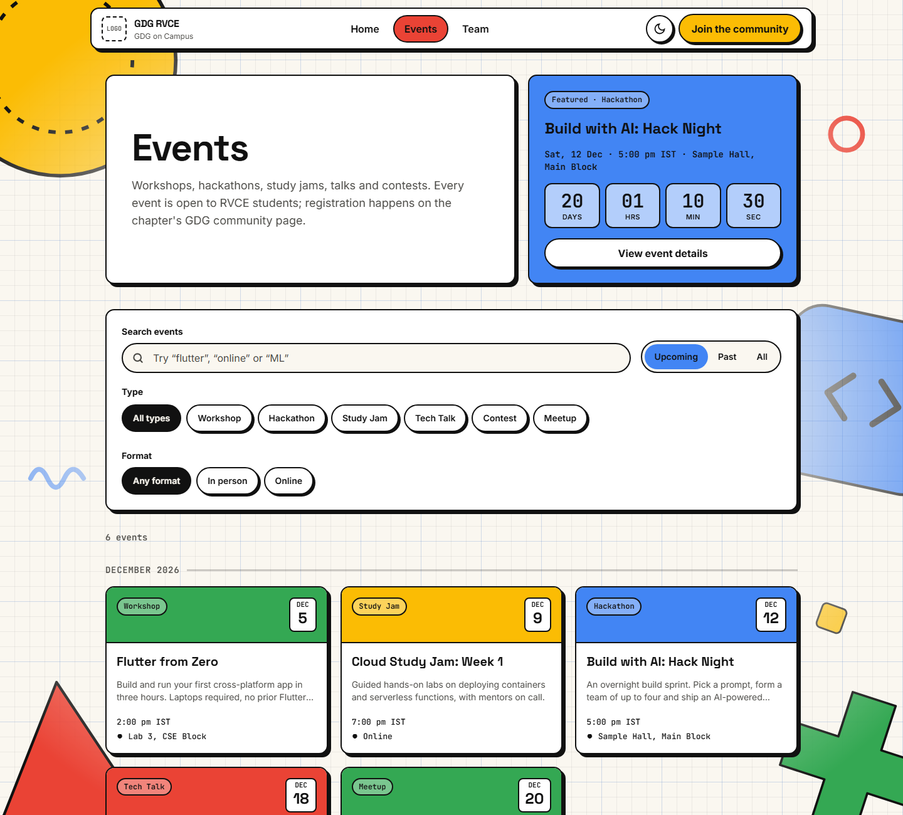
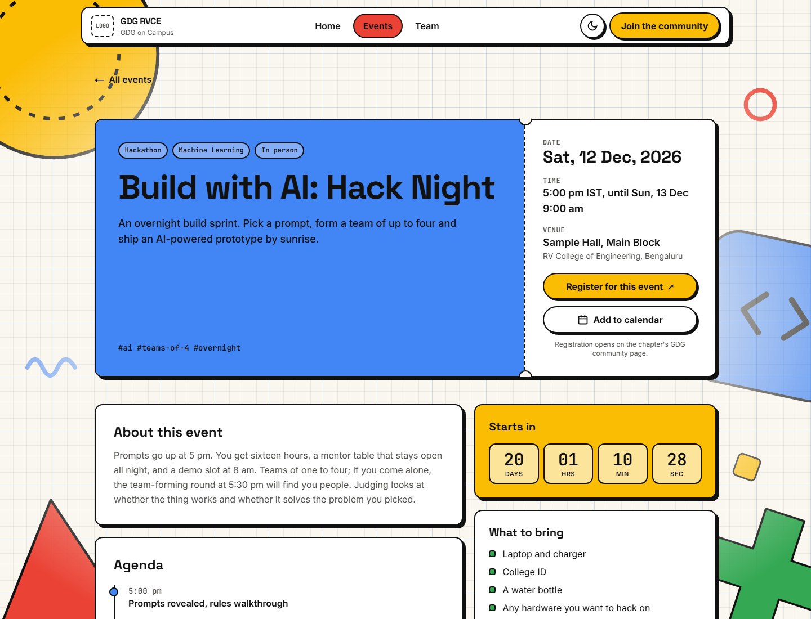
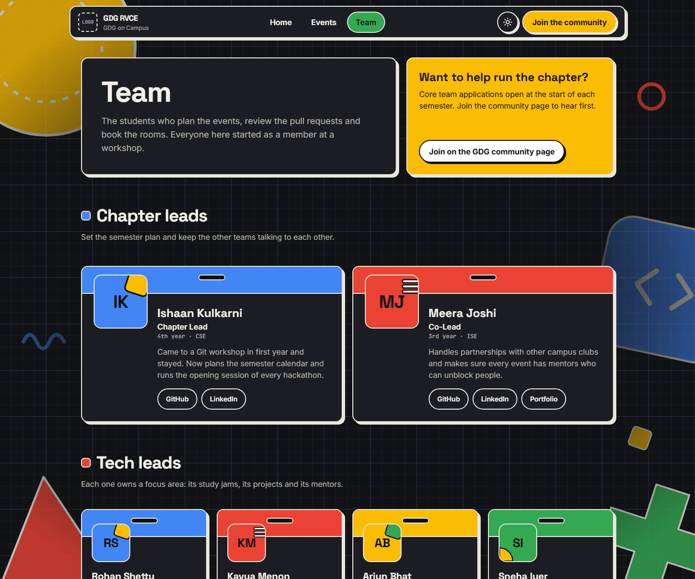
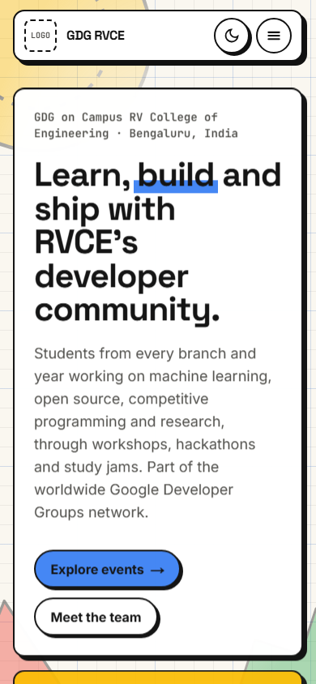
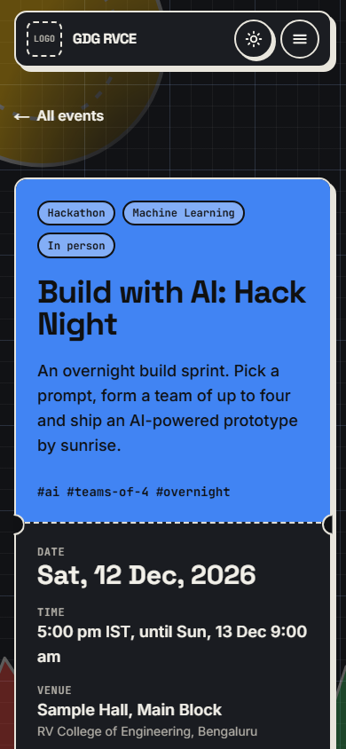

# GDG RVCE website: Interface Unlocked entry

A design and working frontend for the **GDG on Campus RV College of Engineering** community website, built for the *Interface Unlocked* UI Design Challenge. It covers the three pages in the brief (**Home**, **Events** and **Team**) on desktop and phone, in light and dark themes.

**Live demo:** _add your Vercel link here_
**Design note:** [DESIGN_NOTE.md](DESIGN_NOTE.md)

## The idea: bento + neo-brutalism

Each page is a grid of modular tiles of different sizes. Every tile holds one idea, with thick ink outlines, hard offset shadows and flat Google colours. The look is playful and developer-flavoured but stays readable: one radius, one border weight and one shadow, so new pages can be built from the same parts. The full reasoning is in the [design note](DESIGN_NOTE.md).

## Screenshots

| Home (light) | Home (dark) |
| --- | --- |
|  |  |

| Events list with filters | Event detail (ticket) |
| --- | --- |
|  |  |

| Team (dark) | Phone: Home | Phone: Event detail |
| --- | --- | --- |
|  |  |  |

## What's on each page

**Home**
- Bento hero: introduction, two calls to action, a "Next up" tile with a live countdown, and a code-editor tile
- Upcoming events, formats ("What we run") and the chapter's four focus areas
- Latest recap and community links

**Events**
- Search across titles, descriptions, tags and venues
- Filters for Upcoming / Past / All, event type and in person / online
- Results grouped by month, with a live count and an empty state
- **Event detail page** designed as a ticket with a tear-off stub. It shows:
  - date, time and venue (or online details)
  - a registration link and an "Add to calendar" (.ics) button
  - the agenda, a countdown and what to bring
  - a recap instead of registration for past events

**Team**
- Badge-style cards with a lanyard slot and a generated geometric avatar (no photos of real people)
- Chapter leads shown in full; other cards expand in place to show the bio and links

**Across the site**
- Light and dark themes: follows the system setting, with a toggle that remembers the choice
- Skip link, visible focus rings, labelled controls, and tap targets of at least 44 px
- Animations respect `prefers-reduced-motion`
- No analytics, RSVP or interest counters, attendee lists, comments or chat

## Tech

- [Next.js 15](https://nextjs.org) (App Router, every page statically generated) and React 19
- [Tailwind CSS 4](https://tailwindcss.com), with design tokens as CSS variables in `src/app/globals.css`
- TypeScript
- No backend: all content is mock data in `src/data/`

## Run it locally

Requires Node.js 20.19+ or 22+ (Node 22 LTS recommended).

```bash
git clone <your-repo-url>
cd gdg-rvce-site
npm install
npm run dev
```

Open http://localhost:3000.

```bash
npm run build   # production build
npm run lint    # ESLint
```

> `package.json` pins `magic-string` to 0.30.17 through `overrides`. Newer releases are ESM-only and fail on Node 21. You can remove the pin on Node 22+.

## Project structure

```
src/
  app/
    page.tsx                 Home
    events/page.tsx          Events list
    events/[slug]/page.tsx   Event detail (ticket)
    team/page.tsx            Team
    globals.css              Design tokens, themes, shared component classes
  components/                Header, Footer, EventCard, EventsBrowser, MemberCard, Avatar, Countdown, ...
  data/                      events.ts, team.ts (sample content)
  lib/site.ts                Chapter name, nav, links, focus areas
```

## Swapping in official assets

- **Logo:** replace `src/components/LogoPlaceholder.tsx` with the official GDG logo exactly as supplied (no recolouring or stretching, with clear space around it).
- **Chapter name and links:** edit `SITE` in `src/lib/site.ts`.
- **Content:** edit `src/data/events.ts` and `src/data/team.ts`.

## Credits

- Fonts: [Space Grotesk](https://fonts.google.com/specimen/Space+Grotesk), [Inter](https://fonts.google.com/specimen/Inter) and [JetBrains Mono](https://fonts.google.com/specimen/JetBrains+Mono). SIL Open Font License, loaded through Google Fonts with `next/font`.
- Icons and illustrations: hand-drawn inline SVG; avatars are generated from initials.
- Libraries: Next.js, React and Tailwind CSS (MIT).
- Motion and copy principles adapted from [emilkowalski/skills](https://github.com/emilkowalski/skills) and [Leonxlnx/taste-skill](https://github.com/Leonxlnx/taste-skill).
- No third-party logos or photos are used.

All names, bios, events, venues and profile links are made-up sample content. This is a community site and not an official Google product.
